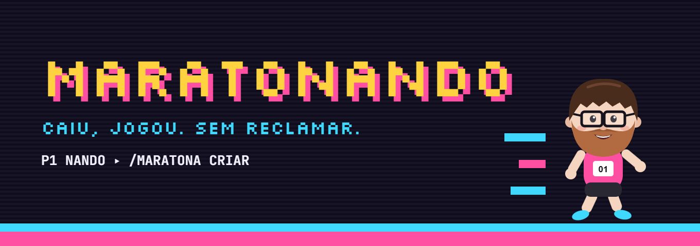

# 🎮 MaratoNando



Bot de Discord para **maratonas de jogos com roleta**. Cada pessoa coloca seus jogos na roleta, o bot sorteia, e o jogo que cair é o que todo mundo joga.

**Regra de ouro: caiu, jogou. Sem reclamar.** (E quem reclamar vai pro Mural da Vergonha. 😤)

## O que ele faz

- **Painel da maratona** com botões: adicionar jogos, ver os seus, sortear e encerrar.
- **Jogos secretos**: ninguém vê os jogos dos outros até eles serem sorteados.
- **Roleta animada**: a roleta passa pelos participantes, para em alguém e revela o jogo.
- **Sem repetição**: jogos repetidos são recusados (sem diferenciar maiúsculas) e cada jogo sai uma vez só.
- **Limite opcional** de jogos por pessoa.
- **Lista pessoal**: lembrou de um jogo no meio da semana? `/lista adicionar` guarda ele. Na maratona, ao clicar em **Adicionar jogos**, a lista aparece para você marcar o que quer colocar na roleta. Jogos sorteados saem da lista sozinhos, e os que não saíram voltam para ela quando a maratona acaba.
- **📡 Radar de jogos**: o bot acompanha streamers escolhidos pelo servidor (ex.: alanzoka) na Twitch, vê o que eles jogam e cruza com a Steam. Só vira sugestão o jogo que é **multiplayer**, **barato** (até R$ 60, configurável) e **bem avaliado** (70%+). Dá para salvar as sugestões direto na lista pessoal, e o bot pode avisar num canal quando aparecer jogo novo.
- **🛒 Sugestões da Steam** (`/sugestao`): jogos co-op online em alta, novidades ou em promoção, filtrados pelas tags da Steam para sobrar só friendslop: precisa ter tag de jogar junto (Online Co-Op, Party Game…) **e** de diversão (Funny, Comedy, Social Deduction, Physics…), nenhuma tag de jogo "sério" (MMO, Competitive, Sports), preço baixo e 80%+ de avaliações positivas.
- **🎮 O que jogar agora?** (`/o-que-jogar`): "estamos em 4, o que dá para jogar?", com ou sem maratona. O bot pega quem está na sua call (ou quem você marcar, ou só o número de pessoas) e sugere: os jogos **que vocês já têm** na Steam e que aceitam exatamente esse número de pessoas, do mais barato para o grupo ao mais caro; e **novidades friendslop** da loja que também servem. Quantas pessoas cada jogo aceita vem da descrição da Steam ("up to 6 players", "1-4 players", "até 4 jogadores"…). Quando a descrição não diz (ou diz errado), qualquer um ensina com `/jogo jogadores` (ex.: Lethal Company = 1 a 4), e o que o grupo ensina vale para sempre.
- **👥 Sorteio de times** (`/times`): começa a lista com quem está jogando a maratona (ou, sem maratona aberta, com quem está na call), pergunta se mais alguém vai jogar e só então sorteia times equilibrados.
- **🧹 Chat limpo**: com `/config canal-do-bot`, o bot ganha um canal próprio onde as mensagens ficam. Em qualquer outro canal, as mensagens dele somem sozinhas depois de alguns minutos (padrão: 10). Se alguém estiver usando os botões de uma mensagem, o prazo recomeça; e o painel de uma maratona aberta só some depois que ela acaba.
- **💸 Avisos de promoção**: a cada 6 horas o bot confere na Steam o preço dos jogos que estão nas listas pessoais. Quando um deles entra em promoção (ou o desconto aumenta), ele avisa no canal do bot marcando (com notificação) só quem tem aquele jogo na lista. O `/lista ver` também mostra quais jogos da sua lista estão em promoção.
- **💰 Mais barato para o grupo** (`/maratona baratos`): cada pessoa vincula a Steam (ou um admin vincula por ela), e o bot cruza as bibliotecas de quem está jogando a maratona. Mostra os jogos multiplayer do mais barato para o grupo ao mais caro: o custo é o preço atual × quantas pessoas ainda não têm. Primeiro aparecem os que todo mundo já tem e os grátis. O mesmo cálculo aparece **no sorteio** ("✅ 3 têm · 🛒 falta para @Bia, R$ 14,87") e, só para quem está colocando, **ao colocar um jogo na roleta**, para todo mundo pensar no bolso dos amigos.
- **🙋 Chegou no meio?** O botão **Tô jogando** do painel coloca a pessoa na maratona mesmo sem jogo na roleta, e ela passa a contar nos times e no `/maratona baratos`.
- **📣 Chamar o pessoal**: com o cargo de jogos configurado (`/config cargo-jogos`), o bot marca o cargo quando alguém abre uma maratona. E o `/chamar [jogo] [pessoas]` posta um chamado marcando o cargo: cada um responde com um clique (✋ Bora · ⏰ Daqui a pouco · ❌ Hoje não), e quando bate o número de pessoas o bot marca só quem confirmou ("Fechou o grupo!"). Com a Steam ligada, mostra quem dos confirmados tem o jogo (ou, sem jogo escolhido, os mais baratos para eles). O cargo é marcado no máximo uma vez a cada 30 minutos.
- **✍️ Nomes digitados de qualquer jeito**: o `/maratona adicionar`, o `/lista adicionar` e o `/chamar` sugerem jogos da Steam enquanto você digita. No formulário de "Adicionar jogos", nomes que não batem com nenhum jogo viram um "você quis dizer…?" (ex.: "letal compani" → **Lethal Company**), e quem quiser pode manter como escreveu (jogos de fora da Steam). Jogos reconhecidos ficam com o nome oficial, e a roleta barra repetidos escritos de outro jeito ("R.E.P.O." = "repo").
- **Mural da Vergonha**: `/reclamou @pessoa`, ou botão direito na pessoa → Apps → **Reclamou!**
- **📅 Maratona agendada** (`/maratona agendar dia hora`): marca a maratona para depois ("sábado" + "21h30", "amanhã", "25/10"…; o dia tem sugestões enquanto digita). O bot posta um convite com **✅ Eu vou · 🤔 Talvez · ❌ Não vou**, coloca no **calendário do servidor** (evento do Discord) e, **15 minutos antes**, abre a maratona sozinho no canal, já com quem confirmou dentro, marcando o cargo de jogos e quem disse "Eu vou". Quem marcou pode cancelar (o evento some do calendário também). Se já tiver uma maratona aberta na hora, o bot só avisa.
- **⭐ Nota dos jogos**: quando o próximo jogo é sorteado (ou a maratona acaba), o bot posta botões de 1 a 5 para avaliar o jogo que acabou de ser jogado. Só quem estava na maratona vota, e dá para trocar a nota clicando de novo. O `/ranking` junta as notas de todas as maratonas e mostra os jogos favoritos do grupo (o mesmo jogo jogado em noites diferentes conta como um só).
- **📊 Estatísticas do grupo** (`/stats`): quantas maratonas, quantos jogos e quantas horas de jogatina o grupo já teve, os jogos que mais saíram na roleta, quem mais coloca jogo (e quantos saíram), o favorito do grupo, o Mural da Vergonha de todos os tempos e um gráfico de maratonas por mês.
- **Resumo final**: o que foi jogado, em que ordem, quem escolheu, a nota de cada jogo, o melhor da noite, o que ficou na roleta e o ranking de reclamações.
- **Aguenta reinícios**: tudo fica salvo em SQLite, e os botões do painel continuam funcionando depois que o bot reinicia.
- Funciona em **vários servidores** ao mesmo tempo (uma maratona aberta por servidor).

## Comandos

| Comando | O que faz | Quem pode |
|---|---|---|
| `/maratona criar [nome] [limite] [avisar]` | Abre uma maratona no canal e posta o painel (marca o cargo de jogos, a não ser que `avisar` seja Não) | Qualquer pessoa |
| `/maratona agendar dia hora [nome] [call]` | Marca a maratona para depois: convite com botões de presença, evento no calendário do servidor e abertura automática 15 min antes | Qualquer pessoa (cancelar: quem marcou ou quem tem *Gerenciar servidor*) |
| `/chamar [jogo] [pessoas]` | Chama o pessoal para jogar, marcando o cargo de jogos | Qualquer pessoa |
| `/maratona adicionar jogo` | Coloca um jogo na roleta, com sugestões da Steam enquanto digita | Qualquer pessoa |
| `/maratona sortear` | Gira a roleta (o mesmo que o botão 🎲) | Quem organizou ou quem tem *Gerenciar servidor* |
| `/maratona painel` | Traz o painel para o fim do chat | Qualquer pessoa |
| `/maratona encerrar` | Encerra e mostra o resumo (pede confirmação) | Quem organizou ou quem tem *Gerenciar servidor* |
| `/maratona baratos` | Jogos multiplayer ordenados pelo custo para o grupo (precisa da Steam vinculada) | Qualquer pessoa |
| `/maratona incluir @pessoa` / `excluir` | Coloca/tira da maratona alguém que está jogando sem jogo na roleta | Quem organizou |
| `/steam vincular perfil [pessoa]` | Liga a conta da Steam ao Discord (a sua, ou a de outra pessoa se você for admin) | Qualquer pessoa / admin para os outros |
| `/steam desvincular [pessoa]` | Desliga a conta da Steam | Qualquer pessoa / admin para os outros |
| `/steam ver` | Mostra quem da maratona tem a Steam vinculada | Qualquer pessoa |
| `/maratona ajuda` | Explica como funciona | Qualquer pessoa |
| `/lista adicionar [jogo]` | Guarda um jogo na sua lista pessoal (sem o nome, abre um formulário para vários) | Qualquer pessoa (só ela vê) |
| `/lista ver` | Mostra sua lista; dá para tirar vários jogos de uma vez e conferir os nomes na Steam | Qualquer pessoa (só ela vê) |
| `/lista remover jogo` | Tira um jogo da sua lista (sugere os jogos dela enquanto digita) | Qualquer pessoa (só ela vê) |
| `/reclamou @pessoa` | Manda alguém pro Mural da Vergonha | Qualquer pessoa |
| `/stats` | Estatísticas do grupo: maratonas, horas, jogos mais sorteados, quem mais coloca jogo, mural de todos os tempos e maratonas por mês | Qualquer pessoa |
| `/ranking` | Os jogos favoritos do grupo, pela média das notas de todas as maratonas (só jogos com 2 notas ou mais) | Qualquer pessoa |
| `/o-que-jogar [pessoas] [jogadores] [preco_max]` | Jogos para o número exato de pessoas: o que vocês já têm (mais barato para o grupo primeiro) e novidades da loja | Qualquer pessoa |
| `/jogo jogadores jogo [maximo] [minimo]` | Mostra quantas pessoas um jogo aceita, ou ensina o bot (o que o grupo ensina vale mais que a Steam) | Qualquer pessoa |
| `/sugestao [tipo]` | Sugestões de friendslop só pela Steam: em alta, novidades ou em promoção | Qualquer pessoa |
| `/sortear-times [quantidade] [jogadores]` | Sorteia times sem ligação com a maratona: marque as pessoas (`@Ana @Bia…`) para sortear na hora, ou deixe vazio para começar com quem está na sua call | Qualquer pessoa (só quem pediu sorteia) |
| `/times [quantidade]` | Monta a lista de quem vai jogar (maratona primeiro, call depois) e sorteia os times (2 a 8) | Qualquer pessoa (só quem pediu sorteia) |
| `/config canal-do-bot [canal]` | Define o canal do bot; fora dele, as mensagens do bot somem sozinhas (vazio = desliga) | Quem tem *Gerenciar servidor* |
| `/config apagar-depois minutos` | Quanto tempo as mensagens ficam fora do canal do bot (0 = nunca apagar) | Quem tem *Gerenciar servidor* |
| `/config promocoes ativo` | Liga/desliga os avisos de promoção (vão para o canal do bot) | Quem tem *Gerenciar servidor* |
| `/config cargo-jogos [cargo]` | Cargo marcado ao abrir maratona e no `/chamar` (vazio = ninguém) | Quem tem *Gerenciar servidor* |
| `/config ver` | Mostra as configurações | Quem tem *Gerenciar servidor* |
| `/radar ver` | Mostra as sugestões de jogos, com menu para salvar na sua lista | Qualquer pessoa |
| `/radar streamers` | Mostra quem o radar acompanha, o preço máximo e o canal de alertas | Qualquer pessoa |
| `/radar adicionar-streamer canal` | Passa a acompanhar um canal da Twitch (nome ou link) | Quem tem *Gerenciar servidor* |
| `/radar remover-streamer canal` | Para de acompanhar um canal | Quem tem *Gerenciar servidor* |
| `/radar alertas [canal]` | Avisa nesse canal quando surgir jogo novo no radar (vazio = desliga) | Quem tem *Gerenciar servidor* |
| `/radar preco-maximo [reais]` | Muda o preço máximo das sugestões (vazio = R$ 60) | Quem tem *Gerenciar servidor* |

## Como rodar no seu PC (Windows)

### 1. Criar o bot no Discord

1. Entre em <https://discord.com/developers/applications> e clique em **New Application**. Dê o nome *MaratoNando*.
2. No menu da esquerda, vá em **Bot** e clique em **Reset Token**. Copie o token que aparecer (ele só aparece uma vez). **Nunca mostre esse token a ninguém**: com ele, qualquer pessoa controla o bot.
3. Ainda em **Bot**, nenhuma das "Privileged Gateway Intents" precisa ser ligada.
4. No menu da esquerda, vá em **OAuth2 → URL Generator**:
   - Em *Scopes*, marque `bot` e `applications.commands`.
   - Em *Bot Permissions*, marque `View Channels`, `Send Messages` e `Embed Links`.
   - Copie a URL gerada no fim da página, abra no navegador e escolha o servidor.

### 2. Preparar a pasta

Abra o terminal (PowerShell) dentro da pasta do bot e rode:

```powershell
python -m venv .venv            # cria um ambiente isolado só para este projeto
.venv\Scripts\activate          # ativa o ambiente (o terminal passa a mostrar "(.venv)")
pip install -r requirements.txt # instala discord.py e python-dotenv
```

### 3. Configurar o token

1. Faça uma cópia do arquivo `.env.example` e renomeie a cópia para `.env`.
2. Abra o `.env` e cole o token depois de `DISCORD_TOKEN=`.
3. **Para testar**, preencha também `DEV_GUILD_ID` com o ID do seu servidor (no Discord: Configurações → Avançado → ligue o *Modo desenvolvedor*; depois clique com o botão direito no ícone do servidor → **Copiar ID do servidor**). Assim os comandos aparecem na hora, em vez de demorar alguns minutos.

### 4. (Opcional) Ligar o radar: chaves da Twitch

O radar usa a API oficial da Twitch, que é gratuita mas pede um cadastro. Sem essas chaves o bot funciona normalmente, só o `/radar` fica desligado.

1. Sua conta da Twitch precisa ter a **verificação em duas etapas** ligada (Twitch → Configurações → Segurança e privacidade).
2. Entre em <https://dev.twitch.tv/console> e clique em **Register Your Application** (Registrar seu aplicativo).
3. Preencha:
   - **Name**: qualquer nome único, ex.: `MaratoNando-SeuNome`.
   - **OAuth Redirect URLs**: `http://localhost` (o bot não usa, mas o campo é obrigatório).
   - **Category**: `Chat Bot` (ou `Other`).
   - **Client Type**: `Confidential`.
4. Clique em **Create** e depois em **Manage** no aplicativo criado.
5. Copie o **Client ID** e cole no `.env` depois de `TWITCH_CLIENT_ID=`.
6. Clique em **New Secret**, copie o segredo e cole depois de `TWITCH_CLIENT_SECRET=`. Assim como o token do Discord, **não mostre esse segredo a ninguém**.

Depois de ligar o bot, use `/radar adicionar-streamer alanzoka` no servidor. O bot olha os clipes do último mês para descobrir o que ele andou jogando, confere cada jogo na Steam, e daí em diante checa a cada 10 minutos o que ele está jogando ao vivo.

### 5. (Opcional) Chave da API da Steam

Usada pelo `/steam vincular` e pelo `/maratona baratos`. É gratuita.

1. Entre em <https://steamcommunity.com/dev/apikey> com a sua conta da Steam.
2. Em **Domain Name**, escreva qualquer nome (ex.: `maratonando`), aceite os termos e clique em **Register**.
3. Copie a chave e cole no `.env` depois de `STEAM_API_KEY=`. Não mostre essa chave a ninguém.

Para o bot ver os jogos de alguém, o perfil precisa estar com **Detalhes do jogo: Público** (Steam → Perfil → Editar perfil → Configurações de privacidade).

### 6. Ligar

```powershell
python bot.py
```

Quando aparecer `Logado como MaratoNando...`, está funcionando. Para desligar, aperte `Ctrl + C` no terminal.

## Identidade visual (Manual da Marca)

O visual segue o Manual da Marca v1: o mascote **Nando**, as fontes **Silkscreen** (títulos em pixel) e **JetBrains Mono** (detalhes), e a paleta:

| Cor | Hex | Onde aparece |
|---|---|---|
| Magenta | `#FF4FA3` | painel da maratona, lista pessoal, /chamar |
| Amarelo | `#FFD23F` | roleta e revelação do jogo |
| Verde | `#45E39A` | resumo final e promoções |
| Vermelho | `#FF5A4E` | Mural da Vergonha |
| Ciano | `#3FD8FF` | radar, sugestões, times, Steam e configurações |

- `marca.py` guarda as cores e o link das miniaturas do Nando. Mudou a marca? Muda só ali.
- `cartoes.py` desenha (com Pillow) o **card da roleta** e o **card do resumo**, que o bot anexa como imagem nos embeds.
- `assets/nando/` e `assets/fontes/` vão junto para a Discloud; `assets/export/` tem o avatar e o banner para colocar no Developer Portal.

**Avatar e banner do bot:** no [Developer Portal](https://discord.com/developers/applications) → sua aplicação → **Bot**, troque o ícone por `assets/export/maratonando-avatar-1024.png` e o banner por `assets/export/maratonando-banner-1360x480.png`. Salve.

**(Opcional) Nando sorrindo/surpreso no canto dos embeds:** depois de subir o projeto para o GitHub, coloque no `.env` o link "raw" da pasta assets, por exemplo `MARCA_URL=https://raw.githubusercontent.com/SEU_USUARIO/MaratoNando/main/assets`. Sem isso, o canto dos embeds usa o avatar do bot (que também é o Nando).

As fontes são livres (SIL Open Font License); as licenças estão em `assets/fontes/`.

## Permissão para o calendário (opcional)

Para o `/maratona agendar` colocar a maratona no **calendário do servidor**, o bot precisa da permissão **Gerenciar eventos**. Sem ela, o agendamento funciona igual (convite, botões e abertura automática), só não aparece no calendário. Para dar a permissão: **Configurações do servidor → Cargos →** o cargo do bot (MaratoNando) **→ Permissões →** ligue **Gerenciar eventos** (em inglês, *Manage Events*; em algumas versões aparece também como *Criar eventos*) e salve.

## Colocando na Discloud

1. **Desligue o bot no seu PC** (`Ctrl + C`). O mesmo bot não pode rodar em dois lugares ao mesmo tempo: os dois responderiam aos comandos e mandariam alertas em dobro.
2. Monte o zip com o script da pasta:
   - **Primeira vez:** `python empacotar_discloud.py --com-banco` (leva o banco de dados, com tudo que você já configurou).
   - **Atualizações:** `python empacotar_discloud.py` (sem o banco, para não apagar o que está rodando lá).
3. Na [Discloud](https://discloud.com), vá em **Dashboard → + Upload → Upload ZIP** e envie o `MaratoNando-discloud.zip` (na primeira vez) ou use a opção de atualizar (commit) do app, nas próximas.

O `discloud.config` já está pronto (`RAM=128`). O zip já leva o `.env` com os tokens; ele **nunca** vai para o GitHub (está no `.gitignore`, assim como o zip).

> **Sobre o `DEV_GUILD_ID`:** para um bot de um servidor só, vale deixar o ID do seu servidor preenchido também na Discloud. Os comandos aparecem na hora e não ficam duplicados. Se um dia o bot for para outros servidores, deixe vazio (os comandos passam a valer em todos, depois de alguns minutos) e limpe os comandos antigos do seu servidor.

## Testes

As regras da maratona (sorteio, repetidos, limite, lista, mural, reinício) e do radar (filtro, ranking, leitura das respostas da Steam) têm testes automáticos que rodam sem precisar do Discord nem de internet:

```powershell
pip install -r requirements-dev.txt
python -m pytest
```

## Estrutura

```
MaratoNando/
├── bot.py             # liga o bot, carrega os comandos e registra no Discord
├── db.py              # banco de dados SQLite e todas as regras da maratona
├── radar.py           # regras do radar: o que é "friendslop" e como ranquear
├── sugestao.py        # leitura da busca da Steam e filtro de friendslop por tags
├── times.py           # divisão equilibrada em times
├── biblioteca.py      # custo para o grupo: cruza as bibliotecas da Steam
├── nomes.py           # nomes parecidos, repetidos e o "você quis dizer…?"
├── jogadores.py       # quantas pessoas cada jogo aceita, lido da descrição da Steam
├── agenda.py          # datas digitadas ("sábado" + "21h30") para o /maratona agendar
├── estatisticas.py    # contas do /stats: horas, mais sorteados, quem mais coloca jogo, por mês
├── notas.py           # notas dos jogos: médias, estrelas e o ranking dos favoritos
├── marca.py           # cores e miniaturas do Nando (Manual da Marca)
├── cartoes.py         # imagens dos cards da roleta e do resumo (Pillow)
├── assets/            # Nando, fontes e o avatar/banner exportados
├── cogs/
│   ├── maratona.py    # comandos, botões, formulários, roleta e embeds da maratona
│   ├── radar.py       # /radar, /sugestao e a coleta automática a cada 10 minutos
│   ├── times.py       # /times
│   ├── limpeza.py     # /config e a faxina das mensagens fora do canal do bot
│   ├── promocoes.py   # vigia de promoções dos jogos das listas
│   ├── steam.py       # /steam e o /maratona baratos
│   ├── chamar.py      # /chamar
│   ├── jogar.py       # /o-que-jogar e /jogo jogadores
│   └── agenda.py      # /maratona agendar: convite, evento do calendário e abertura automática
├── servicos/
│   ├── twitch.py      # cliente da API oficial da Twitch
│   ├── steam.py       # consultas à loja da Steam
│   └── steam_api.py   # API oficial da Steam (perfis e bibliotecas)
├── tests/
│   ├── test_db.py     # testes da maratona e da lista
│   ├── test_radar.py  # testes do radar (com respostas reais da Steam)
│   ├── test_sugestao.py # testes do filtro do /sugestao
│   ├── test_times.py  # testes do sorteio de times
│   ├── test_limpeza.py # testes da agenda de limpeza
│   ├── test_promocoes.py # testes dos avisos de promoção
│   ├── test_biblioteca.py # testes do custo para o grupo e das contas Steam
│   ├── test_chamar.py # testes do cargo de jogos e do /chamar
│   ├── test_nomes.py  # testes de nomes digitados com erro e repetidos
│   ├── test_jogadores.py # testes da leitura do nº de jogadores (com textos reais da Steam)
│   ├── test_agenda.py # testes das datas e dos agendamentos
│   ├── test_estatisticas.py # testes do /stats
│   ├── test_notas.py  # testes das notas e do ranking
│   └── test_cartoes.py # testes das imagens dos cards
├── requirements.txt
├── empacotar_discloud.py # monta o .zip para subir na Discloud
├── .env.example       # modelo do arquivo de configuração
└── discloud.config
```

A separação é proposital: `db.py` e `radar.py` não sabem nada de Discord nem de internet (só recebem e devolvem dados), então as regras podem ser testadas sozinhas. Os `cogs/` cuidam da conversa com o Discord, e os `servicos/` da conversa com a Twitch e a Steam.

## Tecnologias

Python 3.10+ · [discord.py](https://discordpy.readthedocs.io/) 2.x (comandos de barra, botões persistentes, modais, menus de seleção e de contexto) · SQLite · aiohttp (API Helix da Twitch e loja da Steam) · tarefas em segundo plano (`discord.ext.tasks`) · Pillow (imagens geradas) · pytest
